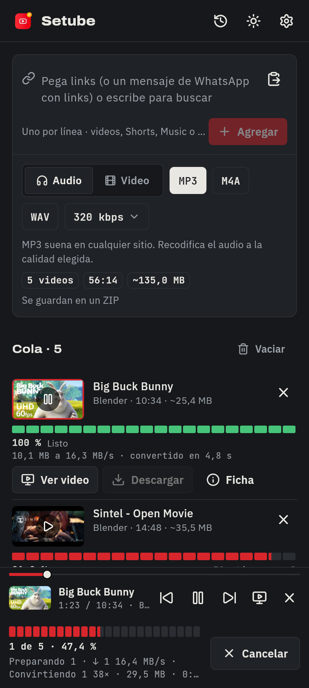
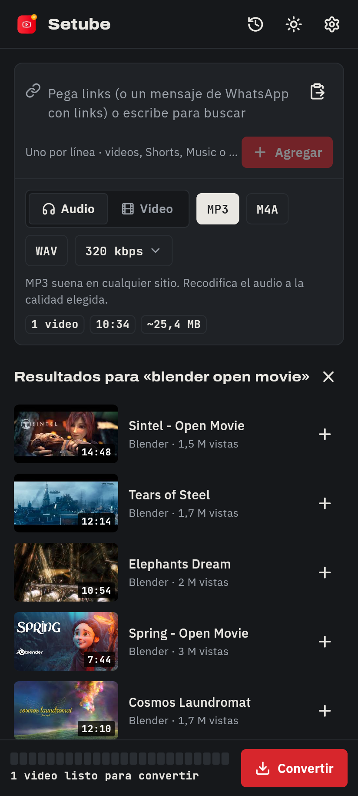
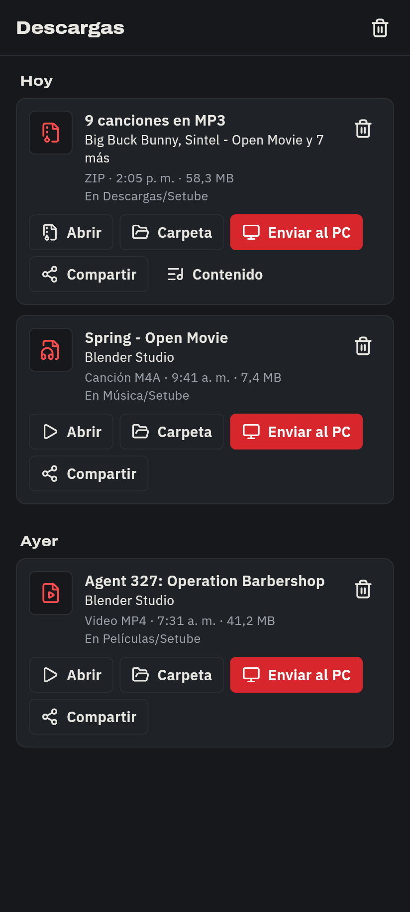
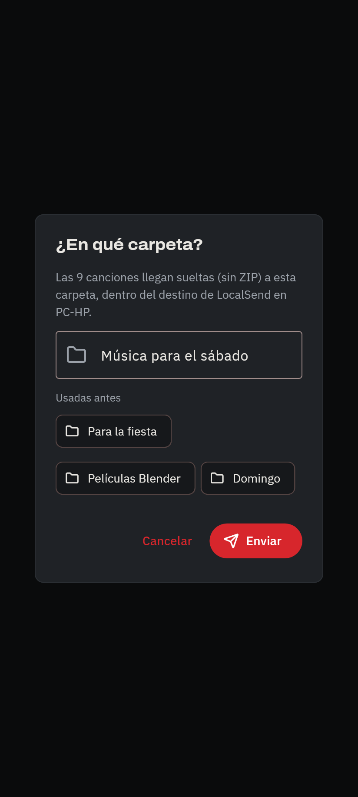
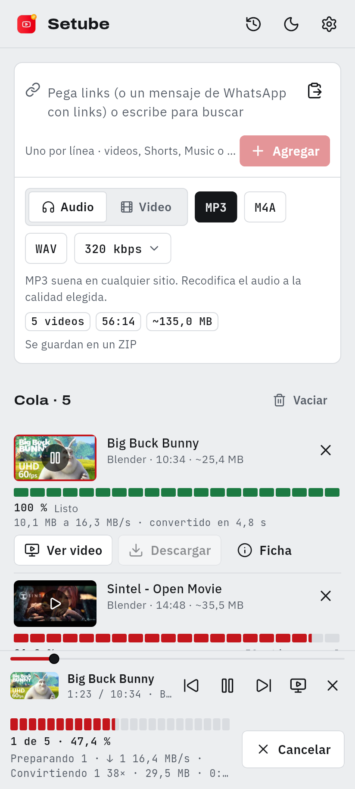

# Setube (Android)

Convertidor de YouTube a MP3, M4A, WAV y MP4 que funciona entero en el teléfono, sin servidor. Pegas links (o un mensaje de WhatsApp con links), eliges el formato y listo. Si son varios, salen en un ZIP.

Hecho por [Sebxstt](https://github.com/GarcesSebastian).

<table>
  <tr>
    <td align="center"><br>Cola</td>
    <td align="center"><br>Búsqueda</td>
    <td align="center"><br>Descargas</td>
  </tr>
  <tr>
    <td align="center"><br>Enviar al PC</td>
    <td align="center"><br>Tema claro</td>
    <td></td>
  </tr>
</table>

<sub>Las miniaturas son películas abiertas de Blender Studio (CC BY).</sub>

## Qué hace

- Links sueltos, playlists, Shorts, Music o búsqueda por texto. También «Compartir» desde la app de YouTube.
- MP3 (128/192/320 kbps), M4A, WAV y MP4 (360p a 1080p), sin límite de duración ni de cantidad.
- Escuchar o ver antes de convertir, con controles en la pantalla de bloqueo.
- Descargas en segundo plano. Un video va a `Music/Setube` o `Movies/Setube`; varios, a un ZIP en `Download/Setube`.
- Registro de descargas: abrir, ir a la carpeta, compartir (WhatsApp) y enviar al PC.
- Envío al PC por la Wi‑Fi con [LocalSend](https://localsend.org). Los ZIP llegan descomprimidos en la carpeta que elijas.
- Sesión de YouTube opcional, solo si YouTube pide confirmar que no eres un bot.

## Instalar

Requisitos: Flutter 3.50 (Dart 3.14), JDK 21 y Android SDK 36. Android 10 o superior en el teléfono.

```bash
flutter pub get
flutter build apk --release --split-per-abi --target-platform android-arm64,android-arm
```

El APK queda en `build/app/outputs/flutter-apk/app-arm64-v8a-release.apk`. La firma de release sale de `android/key.properties` (fuera del repo); sin ese archivo se firma con la clave de debug.

<details>
<summary><b>Cómo funciona sin servidor</b></summary>

| En la API | En la app |
| --- | --- |
| yt-dlp + ffmpeg en Docker | [youtubedl-android](https://github.com/yausername/youtubedl-android) 0.18.1: Python 3.12, yt-dlp, QuickJS y ffmpeg dentro del APK |
| Redis (caché, jobs, cola) | Caché en disco, cola en memoria y un servicio en primer plano. Cada video pasa por tres etapas: preparar, descargar (3 a la vez) y convertir (un ffmpeg por núcleo, hasta 8) |
| `/file` y `/archive` | `FastDownload.kt` baja de googlevideo con 4 conexiones en paralelo y `Convert.kt` convierte con una sola llamada a ffmpeg |
| Proxy de audio y HLS | ExoPlayer pide googlevideo directamente; el video es un MPD de DASH armado en la app (`lib/core/dash.dart`) |
| Servicio `pot` (bgutil) | El PO token de BotGuard lo genera un WebView (como NewPipe) y se lo entrega a yt-dlp un plugin propio por `127.0.0.1` |
| Node para los retos JS | El mismo plugin los resuelve en otro WebView (V8); si falla, yt-dlp usa QuickJS |
| Proxy y cookies | La IP es la del teléfono. Si YouTube aun así bloquea, se usa la sesión |

yt-dlp se actualiza solo una vez por semana, y a mano desde Ajustes, sin instalar otro APK. Ajustes → Diagnóstico prueba un video y muestra PO token, retos JS, formatos y velocidad.

</details>

<details>
<summary><b>Sesión de YouTube</b></summary>

Ajustes → «Iniciar sesión» abre Google en un WebView. La sesión queda en la base SQLite de cookies del WebView, que `CookieStore.kt` lee y convierte en un `cookies.txt` temporal para cada proceso de yt-dlp. Cada 6 horas un WebView sin interfaz abre YouTube para que rote las cookies.

Modos: **solo cuando YouTube la pida** (por defecto), **siempre** o **nunca**. Si Google no deja iniciar sesión, se puede pegar un `cookies.txt`. Usa una cuenta secundaria.

</details>

<details>
<summary><b>Enviar al PC (LocalSend)</b></summary>

Una sola vez:

1. En el PC, instalar LocalSend y permitir el acceso a la red.
2. En LocalSend: activar «Guardado rápido», elegir la carpeta de destino y activar «Iniciar con el sistema».
3. En Setube: Ajustes → Enviar al PC → «Buscar PC» y «Usar este».

`PcSend.kt` busca el PC por multicast y por la red local, se autentica con un certificado de cliente (mTLS, LocalSend 1.18) guardado en el Keystore y fija el certificado del PC. Probado contra LocalSend CLI 1.18.2.

</details>

<details>
<summary><b>Estructura del código</b></summary>

```
lib/
  core/       links, formatos, MP4/DASH, salida de yt-dlp y errores (con tests)
  native/     canales con Kotlin
  services/   YouTube (yt-dlp + oEmbed + cachés)
  state/      cola, búsqueda, reproductor, registro, PC y preferencias
  ui/         pantallas
android/app/src/main/kotlin/com/sebxstt/setube/
  Engine.kt          yt-dlp, política de sesión y diagnóstico
  YtdlpDir.kt        yt-dlp descomprimido y su actualización
  InfoBatcher.kt     info de yt-dlp repartida entre 4 procesos
  FastDownload.kt    descarga en paralelo por tramos
  Convert.kt         conversión con ffmpeg
  Helper.kt          PO tokens y retos JS en WebViews
  CookieStore.kt     cookies del WebView → cookies.txt
  LoginActivity.kt   login de Google
  DownloadService.kt descargas, ZIP, registro y notificaciones
  Player.kt          ExoPlayer y MediaSession
  PcSend.kt          envío con LocalSend
  PcService.kt       cola de envíos
  MainActivity.kt    canales, abrir, compartir y carpetas
test/                pruebas unitarias
```

```bash
flutter analyze
flutter test
```

</details>

## Aviso legal

Setube es para contenido propio o sobre el que tengas permiso. Descargar material protegido sin autorización puede infringir los derechos de autor y los términos de YouTube.
